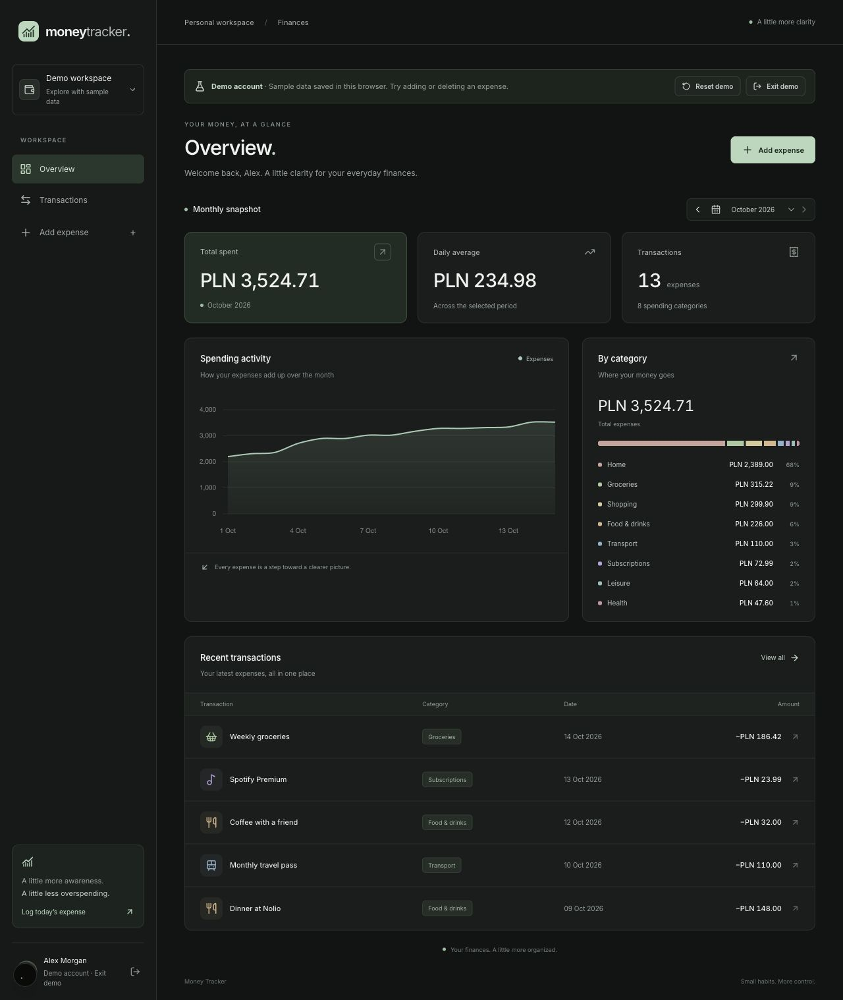
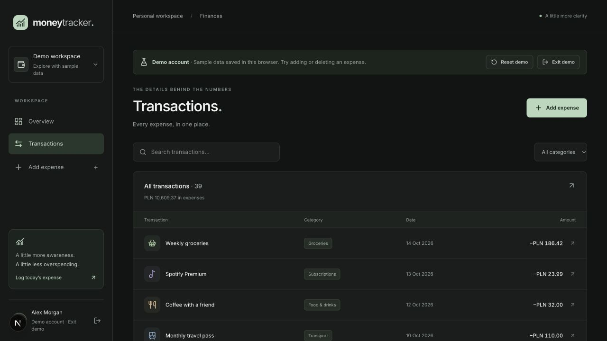
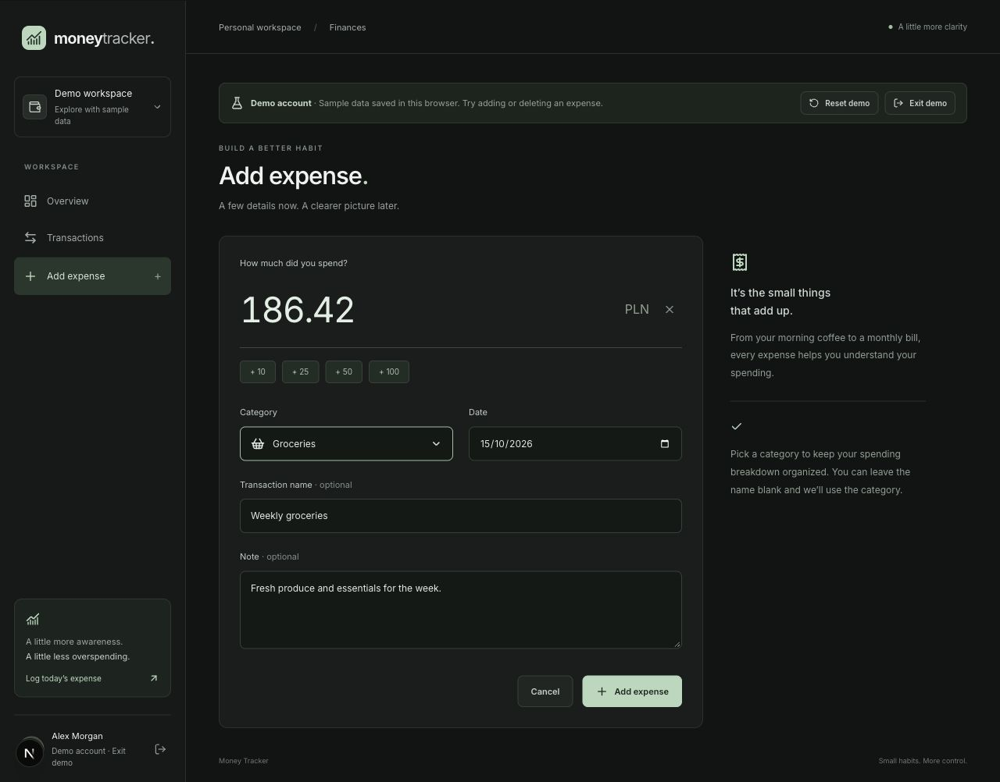
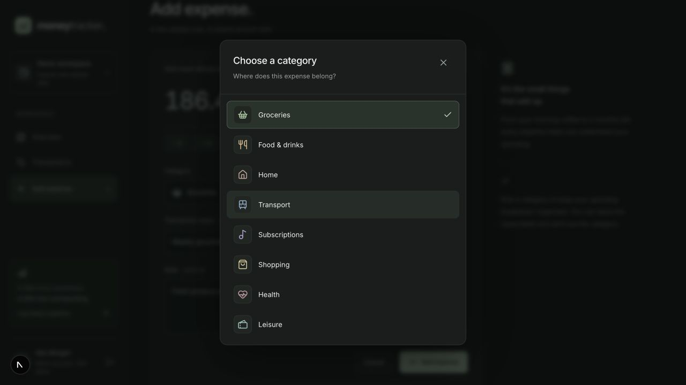

# Expense Tracker App

`Disclaimer: This project is still under active development. Some features are incomplete or may change in the future.`

A simple expense tracking web application that allows users to log in with their Google account, track their spending, categorize expenses, and store everything securely in a cloud database.

## Live Demo
Vercel Deployment: https://money-tracker-qev1.vercel.app/

## Features

- Google login via NextAuth
- Secure storage in MongoDB using the user session ID
- Adding expenses with category, description, and price
- Nice view of existing expenses with help react-chartjs-2
- Icons and colors for category visualization
- Smooth animations using Framer Motion
- Real-time revalidation using SWR
- Responsive UI styled with Tailwind CSS

## Demo account

Choose **Try demo account** on the overview or sign-in screen. No Google account is needed. The demo includes 39 expenses across eight categories and three months, with dates relative to the current month.

Explore the overview, month picker, category breakdown, searchable and filterable history, transaction details, and expense form. Additions and deletions are saved in this browser’s local storage and survive refreshes. Demo operations never write to MongoDB. **Reset demo** restores the original sample transactions; **Exit demo** clears local demo data and returns to the normal account experience. Changes synchronize between open tabs.

Run the demo fixture and storage-validation checks with `npm run test:demo`.

## Tech stack

| Area           | Technology                                   |
| -------------- | -------------------------------------------- |
| Framework      | **Next.js (App Router)**                     |
| Language       | **TypeScript**                               |
| Authentication | **NextAuth (Google Provider)**               |
| Database       | **MongoDB**                                  |
| API            | **Next.js API Routes**                       |
| Styling        | **Tailwind CSS**                             |
| Animations     | **Framer Motion**                            |
| Data fetching  | **SWR**                                      |

## Screenshots

The redesigned interface uses a dark theme with muted mint accents. These screenshots show the local demo account with sample data.

### Overview

Monthly spending, activity chart, category breakdown, and recent transactions.

### Transactions

Searchable expense history with category filters.

### Add an expense

Expense entry with amount shortcuts, category, date, and an optional note.

### Category selection

Category list with icons and a visible selection state.

